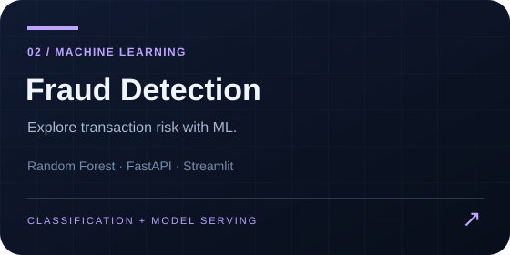
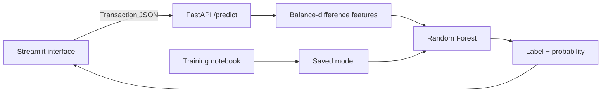

<p align="center"></p>

# AI Fraud Detection System

A transaction-classification project that connects a Random Forest model to a FastAPI prediction service and an interactive Streamlit interface.

**[Open the Streamlit app](https://fraud-detection-jaskirat.streamlit.app/)** · [API guide](docs/API.md) · [Model evaluation](docs/MODEL.md) · [Development guide](docs/DEVELOPMENT.md)

## What it does

- Accepts transaction type, amount and sender/receiver balance information.
- Engineers balance-difference features and returns a fraud label plus model probability.
- Provides a transaction-review dashboard with **Load genuine sample** and **Load fraud sample** buttons. Each loads a labelled notebook transaction; **Analyse transaction** calls the real prediction API.
- Shows engineered balance features, saved evaluation metrics and downloadable prediction JSON.
- Includes the training notebook and serialized model artifacts.

The app is a portfolio demonstration. Its output is a model estimate, not a calibrated financial risk score or a production fraud decision.

## Architecture



## Run locally

Use Python 3.10 or newer. The backend pins scikit-learn to 1.7.2, matching the saved model. The report edition was checked locally on Python 3.12.

```bash
git clone https://github.com/jaskirats01/AI-Fraud-Detection-System.git
cd AI-Fraud-Detection-System
python -m venv .venv
# Activate: source .venv/bin/activate (macOS/Linux)
# Activate: .venv\Scripts\Activate.ps1 (PowerShell)
python -m pip install -r Project/Backend/requirements.txt -r Project/Fronttend/requirements.txt
```

Start the API in one terminal, from its model directory:

```bash
cd Project/Backend
python -m uvicorn app:app --host 127.0.0.1 --port 8000
```

Start the UI in a second terminal from the repository root:

```bash
# PowerShell: $env:FRAUD_API_URL="http://127.0.0.1:8000/predict"
# macOS/Linux: export FRAUD_API_URL="http://127.0.0.1:8000/predict"
python -m streamlit run Project/Fronttend/app.py
```

The UI defaults to the hosted Render API. Set `FRAUD_API_URL` to use a local or alternative API; the deployed default remains unchanged. Local API docs are at `http://127.0.0.1:8000/docs`, and `/health` checks model readiness.

Run the regression and validation checks:

```bash
python -m pip install -r requirements-dev.txt
python -m unittest discover -s tests -v
```

## Results recorded in the notebook

| Measure | Saved result |
|---|---:|
| Training dataset rows | 6,362,620 |
| Test rows | 1,272,524 |
| Fraud-class precision | 0.32 |
| Fraud-class recall | 0.98 |
| Fraud-class F1 | 0.48 |
| Overall accuracy | 99.73% |

These are saved notebook outputs, not newly reproduced benchmarks. High recall comes with substantial false positives. See the [evaluation notes](docs/MODEL.md) for split details, the ROC-AUC calculation caveat and next evaluation steps.

## Repository map

| Path | Purpose |
|---|---|
| `FraudDetection.ipynb` | Exploration, feature engineering, training and evaluation |
| `Project/Backend/app.py` | FastAPI application |
| `Project/Backend/fraud_detection_model.pkl` | Model loaded by the backend |
| `Project/Backend/render.yaml` | Render service configuration |
| `Project/Fronttend/app.py` | Streamlit application; existing folder spelling retained |
| `fraud_detection_model.pkl` | Additional copy of the model at the repository root |

## Next improvements

- Evaluate probability-based ROC-AUC, PR-AUC and threshold trade-offs.
- Evaluate calibration and post-transaction feature availability for a real deployment.
- Document the original dataset source and preserve a complete training environment.

The October 2026 interface revision adds a responsive dark dashboard, input validation, `/health`, configurable API location, JSON export and ten backend regression checks. It does not retrain the classifier or change the saved benchmark results.

Created by **Jaskirat Singh**.
